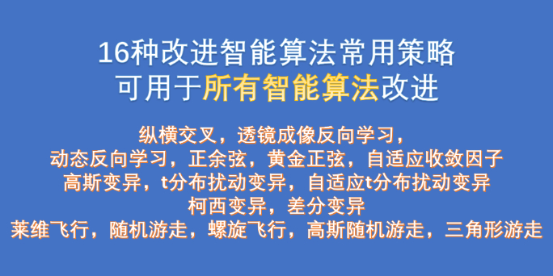

# 16 Commonly Used Intelligent Optimization Algorithms Improvement Strategies

Strategy includes:
1. Levi's flight, 2. Random walk, 3. Helical flight, 4. Gaussian random walk, 5. Triangular walk, 6. Gaussian variation, 7. t-distribution perturbation variation, 8. Adaptive t-distribution perturbation variation, 9. Cauchy variation, 10. Differential variation.
⑪Lens imaging inverse learning ⑫Dynamic inverse learning ⑬Positive and cosine ⑭Golden cosine ⑮Adaptive convergence factor ⑯Cross-cross
Please refer to the article for specific details:
Commonly used intelligent optimization algorithm improvement strategies---Flight Exploration (five strategies) can be applied to enhance all intelligent algorithms, making even beginners capable of improving them.
Common intelligent optimization algorithm improvement strategies---mutation chapter (five mutation strategies) can be used to improve all intelligent algorithms, making even beginners capable of enhancing intelligent algorithms.

## Images

<!-- PAYMENT_BLOCK -->

## Get this dataset

- Payment link (Stripe): [Buy now](https://buy.stripe.com/3cs8yP7sY87d0vu9AB)
- Payment QR code: 

<!-- /PAYMENT_BLOCK -->
